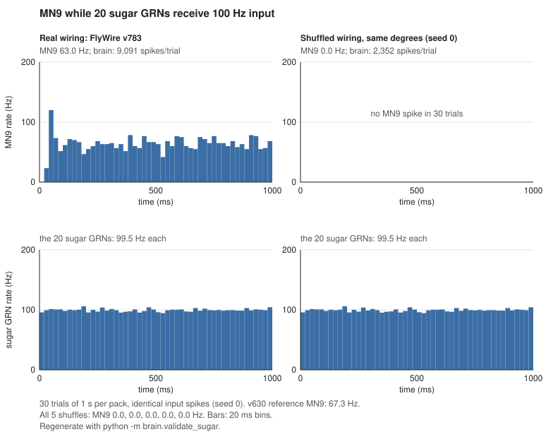
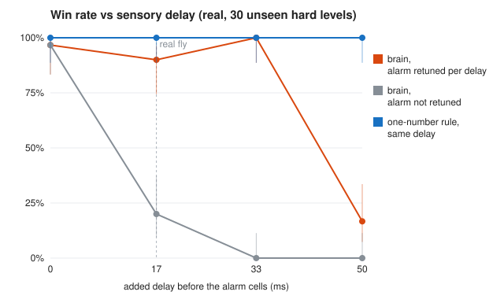

# drosoXgeo — a fruit-fly brain plays Geometry Dash

**Core idea:** Geometry Dash is a one-button *jump* game. Fruit flies already have a jump circuit:
looming-detector neurons (**LPLC2**, **LC4**) see something growing fast on the retina, drive the
**Giant Fiber** neuron (**DNp01**), and the fly jumps away. So the plan is to wire an approaching
spike to the fly's own escape circuit, run it on the real connectome, and see whether that circuit
can time jumps well enough to clear levels.

## Status
- [x] **Phase 1 – Fly Dash game** (`flydash.py`): headless GD-style runner, lock-step, looming signals
- [ ] Phase 0 – Orientation reading
- [x] **Phase 2 – Run the whole-brain model, reproduce a published result** (`brain/`, see results below)
- [x] **Phase 3 – Wire the escape reflex (no training)** (`brain/player.py`, results below)
- [x] **Phase 4 – Controls (the part that makes it science, not a meme)** (`brain/phase4.py`, results below)
- [ ] Phase 5 – Learning (**5A done**, `brain/readout.py`; 5B not started)
- [ ] Phase 6 – Demo video + LinkedIn post

**Next:** Phase 6 (demo + post). The review's checks are done: scrambled-brain activity and targeted lesion (Phase 4c), sensory delay and slow frames (Phase 4d). 5B is future work (see Phase 4b).

Baselines from `python3 flydash.py` (30 levels each):

| policy | easy | normal | hard |
|---|---|---|---|
| random button mashing | 7% progress | 5% | 6% |
| one-number looming threshold | 100% won | 100% won | 100% won |

The fly brain has to beat that bar or explain why it doesn't. On hard (triple spikes) the jump must
fire when the spike is 0.34–0.8 blocks away, a window of about **45 ms**. That is a real timing
test for a spiking network.

---

## Phase 0 – Orientation (a few evenings)
- Shiu et al., *Nature* 2024, "A Drosophila computational brain model reveals sensorimotor processing".
  It is the whole-brain leaky integrate-and-fire (LIF) model everyone builds on.
- Browse FlyWire Codex (codex.flywire.ai). Search the cell types `LPLC2`, `LC4` and `DNp01` and see how they connect.
- Learn the LIF neuron: membrane voltage leaks, inputs add, crossing threshold gives a spike, then a reset.
- Read about Giant Fiber escape (von Reyn et al., 2014 and 2017; Ache et al., 2019 on LPLC2).

## Phase 1 – Game ✅
Why a clone and not the real game: the brain simulation doesn't run in real time, so the game has to
**wait for the brain** each tick. You also get ground truth for plots and thousands of fast runs.

## Phase 2 – Run the fly brain ✅
- **Simulator for the M1 Pro:** `Kisame76/drosophila-brain-mlx` (Apple Silicon / Metal). No Colab needed.
  The original `philshiu/Drosophila_brain_model` (Brian2, CPU) is the reference to check results against.
- The data is already downloaded in `data/`; see `data/SOURCES.md`.
- **Validation:** reproduce one result from the paper (sugar-sensing neurons → feeding motor neuron MN9).
  If you can't reproduce it, nothing later can be trusted.

**Setup** (the simulator is a sibling checkout, `../drosophila-brain-mlx`, and its venv runs our code):
```
cd ../drosophila-brain-mlx
uv venv --python 3.13 && uv pip install -e '.[dev,reference]'
./tools/fetch_upstream.sh && python -m lif.compile_pack        # v630 pack, for the reference check
cd ../drosoXgeo
PY=../drosophila-brain-mlx/.venv/bin/python
$PY -m brain.build_pack                                          # data/pack/v783, labelled flywire-v783
for s in 0 1 2 3 4; do $PY -m lif.shuffle_pack --pack data/pack/v783 --seed $s; done
$PY -m brain.validate_sugar                                      # figures/phase2_sugar_mn9.{svg,json}
```

**Result 1: the MLX engine matches the published Brian2 model (v630).** `python -m lif.validate_notebook`
reran Shiu's example notebook and compared it with the published result files: 15 comparisons, all within |z| < 2.
MN9 at 100 Hz sugar input: 67.0 Hz published vs 67.3 / 67.7 Hz here (two seeds).

**Result 2: it holds on our v783 connectome, and the wiring is what produces it.** 30 trials × 1 s, same input spikes everywhere:

| run | sugar GRNs | MN9 | spikes/trial | neurons active |
|---|---|---|---|---|
| v630 (published setup) | 21 | 67.3 Hz | 9,699 | 408 |
| v630, same 20 GRNs as v783 | 20 | 61.9 Hz | 9,062 | 403 |
| **v783** | 20 | **63.0 Hz** | 9,091 | 402 |
| v783 degree-shuffled, 5 seeds | 20 | **0.0 Hz** (all 5) | ~2,330 | ~100 |

- **Version bridge:** a root ID names one exact segmentation, so an ID present in both v630 and v783 is the same, unedited neuron.
  20 of the 21 sugar GRNs and MN9 keep their IDs. `720575940620900446` was proofread after v630 and is dropped. No mapping by cell type was needed.
- **v630 → v783 on the same 20 GRNs:** 61.9 → 63.0 Hz, within trial noise.
- **Shuffled control:** the sugar GRNs still fire at 99.5 Hz, but activity dies out after ~100 neurons and MN9 never spikes.



**Speed on the M1 Pro** (fused lane, the fastest of 3 runs; `figures/bench_m1pro_*.json`):

| pack, drive | s per biological s | ms per tick | vs real time |
|---|---|---|---|
| v630, 21 sugar GRNs @ 150 Hz (sparse; M4 Pro gets 0.29) | **0.45** | 0.045 | 2.2× faster |
| v783, 100 top hubs @ 150 Hz (dense, 2,241 neurons active) | **1.20** | 0.120 | 0.83×, too slow |

The real game's verdict depends on how much of the brain the looming drive wakes up:
- A sparse drive keeps up with 60 fps.
- A hub-like drive doesn't.

Phase 3 measures this on the actual LPLC2/LC4 drive.

## Phase 3 – Wire the reflex (no training)
1. **Encode.** Map the looming signal (`theta`, `theta_dot`) to Poisson firing rates on LPLC2/LC4 neurons.
2. **Simulate.** Step the brain 1/60 s per game tick.
3. **Decode.** Count DNp01 (Giant Fiber) spikes in a short window; above a threshold, press jump.
4. **First experiment:** does DNp01 fire at all when LPLC2 is driven in the model? How long is the delay?
   The answer is the first plot of the project.

**Progress (2026-10-04):** all four steps run. The player lives in `brain/player.py` (`--watch` shows it live in the terminal);
`brain/tune.py` picks the two alarm-shape knobs on practice levels.
- `brain/stepper.py` advances the brain one frame at a time with input that changes as it goes. It matches the
  validated engine spike for spike (`tests/test_stepper.py`).
- **Experiment 1** (`brain/exp_loom.py`): drive LPLC2/LC4 at 0–200 Hz for 300 ms, 10 trials each.
  - DNp01 fired in every trial once the drive was on.
  - Its first spike comes 4.3 ms after drive onset at 200 Hz and 22.7 ms at 10 Hz.
  - LPLC2 alone drives it almost as well as both together; LC4 alone needs a stronger drive.
  - DNp01 lesioned: 0 spikes.
  - 5 degree-shuffled brains: 0 spikes, except shuffle 4 at 200 Hz (0.8 Hz, first spike after ~216 ms; real wiring: 201 Hz).
- **Checklist:** `python -m brain.checks` reruns all 10 checks (published, control, scrambled, consistency) in ~90 s
  and prints expected vs got with PASS/FAIL. All 10 pass.
- **Pages:** `docs/explainer.html` (plain-language intro) and `docs/testbench.html` (checklist, test grid, spike replays).
  Rebuild the test bench page with `python3 docs/build_testbench.py`.
- **Brain replay** (`docs/brainreplay.html`): watch one hard level frame by frame with all 138,639 neurons drawn
  from the front, lighting up as they fire. `python -m brain.record_level --difficulty hard --seed 1` records it
  (real wiring and a scrambled one), `python3 docs/build_brainreplay.py` builds the page.
  On hard level 1 the real brain wins with 11 jumps and 652 different neurons fire at some point. The scrambled brain's
  alarm cells fire just the same, but the signal goes nowhere: 0 jumps, crash at 12%.

**Result: the escape circuit plays Fly Dash (2026-10-04).** `python -m brain.tune --setup real` (54 min on the M1 Pro)
picks the two alarm settings on 6 practice levels, then plays 30 unseen levels per difficulty with them, once.
- **Chosen on practice:** r_ref 5 Hz, steep 2.
- **Unseen levels:** easy 30/30 won, normal 30/30, hard 29/30 (mean progress 99%). Results: `figures/phase3_play_real.json`.
- **Timing:** the brain takes off a median 0.41 blocks from the spike (10th–90th percentile 0.27–0.55), on every
  difficulty. On hard that's inside the ~45 ms window.
- **The one loss** (hard level 117, at 74%): on a triple spike the Giant Fiber fired a single early spike while the alarm
  was still weak (1.4 Hz), 0.94 blocks out, just outside the window, and the fly landed on the third spike. The input
  spikes are random (Poisson), so the jump cell sometimes fires early. That's noise in the model, and it isn't hidden.
- **Does the wiring matter?** Yes; see Phase 4.

## Phase 4 – Controls
- **Shuffled connectome:** same neurons and same connection counts, but rewired at random.
  If it plays just as well, the fly's wiring wasn't doing the work.
- **Silence DNp01:** the brain should lose the ability to jump.
- **Compare against the one-number baseline** above.

**Result (2026-10-04): the wiring does the work.** Every row used the same protocol: settings picked on the
6 practice levels, then one pass over the same 30 unseen levels per difficulty (seeds 100–129, 300 blocks).
The six control brains took 17 min in total (`results/run_phase4.sh`). `python -m brain.phase4` builds the table
(`figures/phase4_controls.json`).

| setup | easy | normal | hard | median takeoff, hard |
|---|---|---|---|---|
| **real FlyWire wiring** | **30/30** | **30/30** | **29/30** | 0.41 blocks |
| Giant Fiber silenced | 0/30 | 0/30 | 0/30 | never jumps |
| scrambled wiring, 5 seeds | 0/30 each | 0/30 each | 0/30 each | never jumps |
| random button mashing (5% of frames) | 0/30 | 0/30 | 0/30 | – |
| one-number rule (θ > 1.14 rad) | 30/30 | 30/30 | 30/30 | 0.69 blocks |

- **Scrambled and silenced brains never jumped once,** in any of 1,080 levels (90 practice runs over 15 alarm
  settings plus 90 test levels, for each of the 6 control brains). Their alarm cells fire as usual; the signal doesn't
  reach the Giant Fiber. They die at the first spike (5% progress).
- **The real brain matches the one-number rule but doesn't beat it** (89/90 vs 90/90). That rule is the idealised
  reflex the circuit implements, so it's the ceiling. The brain jumps later (0.41 vs 0.69 blocks), nearer the edge of
  the safe window, which is how its one noisy early spike cost a level.
- **Caveat:** the alarm search tops out near 160 Hz (r_ref 12, steep 3). In Experiment 1, scrambled brain 4 gave the
  Giant Fiber a weak 0.8 Hz at a constant 200 Hz drive, but only after ~216 ms, far too slow to clear a spike.
  So "never jumps" holds for the alarm range the real brain was tuned in.

## Phase 4b – How much of the brain does the work? (review follow-ups, 2026-10-05)
An outside review asked whether the whole brain plays, or just one wire. Every row below used
the same protocol: settings tuned on practice seeds 0–5, then the 90 unseen levels played with **5 draws of the
random input spikes** (450 plays), with a 95% interval (Wilson).

| setup | what's left of the brain | tuned settings | won | 95% interval |
|---|---|---|---|---|
| **full brain** | all 138,639 neurons | r_ref 5, steep 2 | 434/450 = **96.4%** | 94.3–97.8% |
| **direct wire** (`--setup wire`) | only LPLC2/LC4 → Giant Fiber; every other neuron silenced | r_ref 5, steep 1 | 448/450 = **99.6%** | 98.4–99.9% |
| **one-neuron stand-in** (`brain/standin.py`) | one LIF neuron, same physics, one tuned weight | r_ref 3, steep 1, 6 contacts | 449/450 = **99.8%** | 98.8–100% |
| one-number rule | – | θ > 1.14 rad | 90/90 (deterministic) | 95.9–100% |
| scrambled / Giant Fiber silenced | (Phase 4) | | 0/90 | |

- **The escape pathway alone plays better than the whole brain.** The direct wire and the one-neuron stand-in
  both beat the full brain, and the intervals don't overlap. The rest of the brain doesn't help at this task; it adds
  misfires. The full brain's 16 losses are spread over 14 levels (early or late jumps), the direct wire's 2 over 2.
- **Why the rest of the brain might add noise:** the Giant Fibers get 9,474 input synapses from 862 neurons. LPLC2
  supplies 11% and LC4 9%; the other 80% comes from elsewhere, and half of all the input is inhibitory.
- **Not just a lucky setting:** at the same setting (r_ref 5, steep 1), the full brain won 3/6 practice levels and
  the direct wire 6/6. Overall, 9 of 15 practice settings were perfect for the direct wire vs 7 of 15 for the full brain.
- **The stand-in reproduces the Giant Fiber's timing:** with 3 contacts per alarm spike (FlyWire averages 2.9 for
  LPLC2, 3.9 for LC4), its first spike comes 22.8 ms after onset at 10 Hz (real brain 22.7) and 4.5 ms at 200 Hz (4.3).
- **The original 89/90 was a slightly lucky draw:** the full brain's five draws gave 89, 87, 88, 84, 86. The
  brain-vs-one-number-rule gap is not significant; the stand-in had 3 tuning knobs, the brain and the rule 2 and 1.
- **What this means for the claim:** not "the whole fly brain plays Geometry Dash", but **"the fly's escape pathway,
  wired as in the FlyWire connectome, plays it untrained; scrambling the wiring breaks it."** At this task, the
  pathway is a good doorbell, and the rest of the brain adds a little static.
- **Learning center (5B check):** no MBON connects directly to the Giant Fiber (0 of 9,474 synapses). 23 MBONs reach
  it in 2 steps, but the first step is thin (best: MBON20 → DNp70, 6–9 synapses ≈ 2.5 mV per spike vs ~7 mV to
  threshold; DNp70 → Giant Fiber is strong, 248–339). Learning could at most nudge the jump, so 5B is future work.
- **Real fly's delay (for the delay sweep, #5):** stimulus to Giant Fiber response is about **19 ms** (Ache et al. 2019,
  seen in search excerpts; check in the paper). LC4 → Giant Fiber is ~1.3 ms (von Reyn et al. 2017). The model
  responds ~2 ms after the alarm cells, so it is missing ~17 ms of early visual processing, one game frame.

## Phase 4c – Is the scrambled brain just dead? And the targeted lesion (review #2, 2026-10-18)
**The shuffle keeps what it should** (checked on all 5 packs, `lif.shuffle_pack`): every neuron keeps its sign
(all outputs excitatory or all inhibitory, 0 mixed rows), its in- and out-degree, and its own outgoing synapse
counts. What changes is where strong input lands: in the real brain it piles onto a few cells (99.9th percentile of
excitatory input 7,694 synapses vs ~3,950 shuffled), and the Giant Fibers get ~2,400 excitatory synapses each vs ~1,000.

**Activity check** (`python -m brain.activity`, `figures/activity_check.json`): 300 random ordinary neurons (below the
90th percentile of in- and out-degree, not in the escape circuit) driven at 100 Hz for 1 s, the same input spikes in
every brain, 5 draws. Counted: the rest of the brain.

| brain | spikes | neurons active |
|---|---|---|
| real | 273,725 | 5,550 |
| scrambled, 5 seeds | 1,743–1,924 (**~150× fewer**) | 238–253 |
| scrambled 0, every synapse ×2.83 (`--match shuffled0`) | 275,102 (matched) | **29,873** |

- **Yes, a scrambled brain is mostly quiet,** on any input, not just the looming drive. The review's worry was right.
- **No single volume knob fixes it.** At ×2.83 the spike count matches, but it is spread over 5× as many neurons.
  Matching the number of active neurons instead (×2.38) leaves 7× fewer spikes. ×2 is still quiet, ×4 lights up
  78,000 neurons. The real wiring concentrates activity on particular cells; scrambled wiring can't, at any gain.

**Game rerun** (same protocol as Phase 4: tuned on practice seeds 0–5, then the 90 unseen levels, one draw):

| setup | what changed | tuned settings | easy | normal | hard | won (95% interval) | median takeoff, hard |
|---|---|---|---|---|---|---|---|
| real | – | r_ref 5, steep 2 | 30/30 | 30/30 | 29/30 | 89/90 | 0.41 blocks |
| **gain-matched scramble** (`--setup shuffled0g2.83`) | scramble 0, synapses ×2.83 | r_ref 2, steep 1 | 0/30 | 0/30 | 0/30 | **0/90** (0–4.1%) | never jumps |
| **targeted lesion** (`--setup cut`) | only the 293 LPLC2/LC4 → Giant Fiber edges (1,885 synapses) removed | r_ref 5, steep 3 | 22/30 | 23/30 | 18/30 | **63/90 = 70%** (60–79%) | 0.29 blocks |

- **The gain-matched scramble never jumped once** in 180 levels (6 practice levels × 15 settings, plus the 90 test
  levels). As busy as the real brain, and its Giant Fiber stays silent. So the scramble control is about wiring,
  not about a dead brain.
- **The direct synapses aren't the only way in.** With them cut, the alarm still reaches the Giant Fiber through
  2-step routes, and the brain plays 70% of levels. Practice even looked perfect (6/6 hard at steep 3).
  It jumps later (0.29 vs 0.41 blocks) and loses at random points along a level, not at the first spike.
- **The routes:** 211 neurons get input from the alarm cells and connect to the Giant Fiber. The main excitatory
  relays are PVLP151 (3,228 synapses in from LPLC2/LC4, 190 out to the Giant Fiber) and PVLP122b (1,332 in, 281 out);
  smaller ones are DNp103 and AMMC-A1. Others inhibit the Giant Fiber (LHAD1g1, PVLP024, PVLP010). These are wiring
  counts only; we haven't tested which relay the model actually uses.
- **Together with Phase 4b:** the direct synapses alone play best (99.6%), the full brain without them still plays
  (70%), and the Giant Fiber itself is required (0%). The circuit has a fast main road and slower side roads.

## Phase 4d – Timing: sensory delay and slow frames (review #5 and #6, 2026-10-18)
**Sensory delay** (`python -m brain.delay run`, then `summary`; 67 min, 4 jobs at a time;
`figures/delay_sweep_real.json`). In Fly Dash the alarm cells see the game instantly; a real fly takes ~19 ms from
light to the Giant Fiber, and the model covers only the last ~2 ms. `brain.player --delay-ms D` feeds the alarm cells
what the game showed D ms earlier. Each delay got the full protocol (alarm tuned on practice seeds 0–5, then the 30
unseen hard levels once), with the grid extended to r_ref 20 and 30 at every delay. At 0 ms it reproduces Phase 3
exactly (same practice scores, 29/30).

| added delay | brain, alarm retuned | 95% interval | median takeoff | brain, alarm not retuned (r_ref 5, steep 2) | one-number rule, same delay |
|---|---|---|---|---|---|
| 0 ms | r_ref 5, steep 2: **29/30** | 83–99% | 0.41 blocks | 29/30 | 30/30 (θ > 1.14) |
| **17 ms (real fly)** | r_ref 8, steep 2: **27/30** | 74–97% | 0.36 | 6/30 | 30/30 (θ > 0.98) |
| 33 ms | r_ref 20, steep 3: **30/30** | 89–100% | 0.31 | 0/30 | 30/30 (θ > 0.82) |
| 50 ms | r_ref 30, steep 2: **5/30** | 7–34% | 0.44 | 0/30 | 30/30 (θ > 0.74) |



- **With the fly's real delay, the brain still plays,** once the alarm is tuned for it (27/30, interval overlaps 0 ms).
  A late eye needs an earlier alarm: r_ref climbs from 5 to 8 to 20. Without retuning, 17 ms alone drops it to 6/30.
- **It holds to 33 ms and breaks by 50 ms.** At 50 ms the best setting sits at the top of the grid (r_ref 30) and
  won 5/6 practice levels but only 5/30 unseen ones. 17 vs 33 ms (27 vs 30) is within noise (one draw each).
- **The one-number rule shrugs off every delay** by lowering its threshold. It sees the exact angle; the brain sees
  it through noisy spiking cells, so the brain's timing margin is what runs out.
- **For the real game:** screen capture and key events add lag on top of the fly's 17 ms. Up to ~33 ms total is
  fine if the alarm is retuned for it; ~50 ms is not. The lag has to be measured and the alarm tuned to it.

**Slow frames** (`python -m brain.frametime`, idle M1 Pro, 10 unseen hard levels, tuned settings, every frame timed:
one game frame = 166–167 ticks of simulation, synced back to the CPU; `figures/frametime_*.json`). Budget for live
play: 16.7 ms per frame.

| brain | frames | p50 | p95 | p99 | max | frames over 16.7 ms |
|---|---|---|---|---|---|---|
| **full brain**, all frames | 17,310 | 11.0 ms | 18.7 | 25.4 | 45.7 | 31% |
| full brain, alarm on | 7,819 | **17.1** | 19.9 | 29.6 | 45.7 | **64%** |
| full brain, takeoff frame + 2 before | 948 | 11.5 | 18.5 | 24.1 | 37.0 | 8% |
| direct wire, all frames | 17,310 | 10.9 | 18.2 | 21.3 | 24.0 | 7% |

- **The average hides it, as the review warned.** The median frame fits (11 ms), but while the alarm is on, the full
  brain needs more than a frame's time on 64% of frames, up to 46 ms. The busiest frames come just *after* takeoff,
  when the spike passes closest and the alarm peaks; the frames that decide the jump are mostly in budget (8% over).
- **~11 ms is the engine's floor, not the brain's work:** the direct wire, with all but 316 neurons silenced, also
  takes 10.9 ms. Most likely the cost of 167 ticks × 2 GPU kernel launches per frame (not profiled yet).
- **For Stretch B:** live play on the M1 Pro would fall behind exactly while obstacles are close. Options: the game
  slow-down mod (the honest fallback), batching several ticks per kernel launch, or a faster Mac. A frame running
  late adds lag, and per the delay sweep, the brain tolerates ~33 ms of retuned lag, not 50.

## Phase 5 – "Training" (be precise about what learns)
The connectome's synapse weights are fixed. Learning can live in only two places:
- **A. Trained readout.** Treat the brain as a fixed "reservoir" and learn only the output mapping
  (e.g. logistic regression from neuron rates to jump). Run the shuffled control again.
- **B. Dopamine-gated plasticity.** Let a small set of mushroom-body synapses (Kenyon cell → MBON) change,
  with reward or punishment delivered through dopamine neurons (PPL1). Flies actually learn this way.

**Result 5A (2026-10-04): a trained readout doesn't beat the fly's own jump neuron, and a readout that can see
the input fools the controls.** `python -m brain.readout run --setups real,lesion,shuffled0,...,shuffled4` then
`python -m brain.readout summary` (`figures/phase5a_readout.json`). About 3.5 h on the M1 Pro, 4 jobs at a time.
- **Method.** The brain stays fixed. It watches 30 practice levels (seeds 0–9, all difficulties) while a teacher plays.
  A ridge regression learns the spike's distance from the neurons' spike counts (this frame and the last), with the
  strength picked by cross-validation across practice levels. On the 90 unseen levels it jumps when its estimate
  drops below 0.6 blocks (the middle of the safe window). Every brain trains its own readers the same way, with the same eye.
- **Reader A** reads every neuron that fires, including the LPLC2/LC4 alarm cells we drive. **Reader B** reads only
  neurons downstream of them.

| brain | untrained Giant Fiber (Phase 3–4) | Reader A, all neurons | Reader B, downstream only |
|---|---|---|---|
| real FlyWire wiring | **89/90** | 80/90 | 34/90 |
| Giant Fiber silenced | 0/90 | 80/90 | 30/90 |
| scrambled wiring, 5 seeds | 0/90 each | **90/90 each** | **0/90 each** |

- **The fly's Giant Fiber beats every reader we trained** (89 vs 80 on the real brain). The readers aim well (median
  takeoff 0.57 blocks, right where we pointed them, vs 0.41 for the Giant Fiber), but about 7% of their jumps come far
  too late (< 0.3 blocks): better aim, worse reliability. They estimate distance from one noisy 1/60 s frame; the
  Giant Fiber effectively adds up the alarm over time.
- **Reader A plays perfectly on every scrambled brain.** It decodes the alarm cells, whose firing *is* our input
  signal, so it measures the input, not the wiring. A likely reason the scrambled brains do even better (not
  tested): without the real wiring, nothing feeds extra activity back into the alarm cells. **Lesson: a readout that
  can see the driven neurons is not a test of the connectome.**
- **Reader B is the fair test, and it supports the wiring claim.** Downstream of the alarm cells, the real brain
  carries enough to win 34/90. The scrambled brains carry nothing: their Reader B training error (0.78 blocks) equals
  always guessing the average (0.79), and they win 0/90.
- **With a reader, the Giant Fiber isn't needed** (silenced brain: 80/90 and 30/90). The looming information reaches
  other downstream neurons as well.
- **Takeaway for the demo:** the honest showcase stays the untrained escape circuit. Learning a readout added nothing
  to performance, and its controls show why readouts need care.

**Not recommended:** PPO or backprop on all 50M connectome weights.
- Spikes aren't differentiable.
- PPO is built for differentiable policy networks.
- Once every weight has been retrained, it is no longer the fly's wiring, just a spiking network that started from a fly-shaped layout.

## Phase 6 – Demo
- Side-by-side video: game | spike raster of LPLC2 → DNp01 | jump presses.
- Post the controls; most fly-brain game demos don't have them.
- Credit FlyWire / Shiu et al. Connectome data is CC BY-NC 4.0: fine for a personal post, not for commercial use.
- **Illustration clip (2026-11-01, Rajan's idea):** a cartoon fruit fly at an RGB gaming rig (Blender 5.2,
  `docs/build_clip.py`, all geometry and materials from the script; caption `docs/build_caption.py`). Honest
  parts: the monitor plays a real recorded attempt (`brain.live --press --layer figures/dopamine_slab_practice.json
  --record --seconds 90`, learning off: 6 attempts, 5 reached block 153; attempt 2 used, title bar cropped), and the
  fly's leg presses the space bar, which glows cyan, on exactly the frames the model pressed. Everything else is
  illustration, and the caption says so. Recipe: frames and press timeline from the npz/json into `results/clip/`
  (screen_crop/, timeline.json), then `Blender -b -P docs/build_clip.py -- --render` (476 frames, ~4.3 s each on
  the M1 Pro), then ffmpeg (`fly_gaming_captioned.mp4`, 1080×1080, 30 fps). `-- --wide` renders a 16:9 version
  (1920×1080, same height of view, more room either side; caption `build_caption.py -- --wide`).
- **Walls chart** (`docs/build_walls_chart.py` → `results/clip/walls.png`, 2400×1350): where the 203 real-game
  attempts of 2026-11-01 ended (attempts with another app in front left out, 31 of 234), over a silhouette of the
  level. Slab 1 (153) 88, slab 2 (160–161) 31, after the pit (101) 17; best 173.9. The page and image stay in
  results/ because the silhouette is the level's layout (RobTop's content).

## Stretch A – Full vision (the fly actually sees the screen)
- Instead of handing the brain a ready-made looming number, map downscaled game frames onto the fly's
  eye map: photoreceptor and lamina columns in the optic lobe, each with a position in the visual field.
- The fly's own motion detectors (T4/T5) and looming detectors (LPLC2) then have to work out
  "something is coming" by themselves. It's harder, and much more impressive if it works.
- First check: does a looming square on screen drive LPLC2 in the model at all?

## Stretch C – Learning to time jumps (stopped at stage 2, 2026-10-20)
**Question.** The escape reflex can't do Stereo Madness's block sections: the right takeoff depends on where the cube
will land (README "The block sections"). Can the fly *learn* that timing by trial and error, with learning only
where the rules allow it (a readout with the brain fixed, or dopamine-gated Kenyon cell → MBON synapses)? And would
the result still say something about the fly's wiring?

**What we already know** (measured, 2026-10-19 unless noted):
- **The brain gets one number per frame** ("how close is the danger"). It can't tell a lone spike from a spike before
  a step, so no learning can time those differently. Learning first needs a richer input.
- **The mushroom body doesn't hear the alarm.** On paper LPLC2/LC4 reach 189 Kenyon cells in two excitatory steps
  (mostly KCg-d, the visual ones). In the full model, the alarm at 50 or 200 Hz for 1 s makes **0 of 5,177 Kenyon
  cells** fire (6 of 96 MBONs, 2 of 331 dopamine neurons at 200 Hz). Plasticity at KC → MBON needs active KCs.
- **The mushroom body barely reaches the Giant Fiber** (Phase 4b: 0 direct synapses, weak 2-step routes).
- **Readouts can fool the controls** (Phase 5A): a reader that sees the driven cells learns our input, not the wiring.
  Only a reader of downstream neurons is a fair test, and it needs the full brain.
- **The full brain is too slow for the live game** (Stretch B: 1.3–1.5× slower than real time while the alarm is
  on). Anything that reads downstream neurons is clone-only, watch-only, or needs the game slowed (a mod; ask Rajan).

**Route R: a readout learns, the brain stays fixed** (the feasible one). Stages, each with a go/no-go gate:
1. **Context in the input.** Give each of the 210 LPLC2 and 104 LC4 cells the looming in *its own* patch of the
   visual field, so a step ahead and a pit ahead drive different cells. Needs each cell's receptive-field position,
   which the files we have don't give (one point per neuron). **Rajan:** download FlyWire synapse positions or the
   visual column map from Codex (Google sign-in; `data/SOURCES.md`). Faking positions would not be honest.
   *Gate:* the real brain still plays spike levels as before (the Giant Fiber still fires on time).
2. **Does context survive downstream?** Train a downstream-only reader (as Reader B, Phase 5A) to tell what's coming
   (spikes / step / pit / platform edge) from the clone's terrain levels. *Gate:* the real wiring carries it clearly
   better than the 5 shuffled brains (same reader, same training). If the shuffled brains do as well, the wiring
   adds nothing and we stop. (The input itself always carries it, so "input-only" is a reference, not a control.)
3. **Learn the timing.** First by imitation (a planner's takeoffs as the teacher, like 5A: cheap, a few hours), then
   by trial and error (reward = blocks survived, the reader's weights only, e.g. REINFORCE). On the clone's terrain:
   practice seeds to learn, unseen seeds to score. Controls: the same learning on shuffled and Giant-Fiber-silenced
   brains, and an input-only reader. *Success:* unseen terrain progress clearly above the reflex (18%) and the best
   one-number rule (20%), with non-overlapping intervals, and clearly above the shuffled brains given the same reader.
4. **Real game:** watch-only replays of recordings (the full brain can't run live), or live with the game slowed
   down if Rajan approves a mod.
- **Cost:** stage 1 ~1–2 days after the download; stage 2 ~1 day of runs; stage 3 imitation ~1 day, trial and error
  days of GPU time (one 300-block terrain level ≈ 20–40 s on the full brain, and learning needs thousands of plays).
- **Expected honest outcome:** a reader can likely learn the timing; the open question is whether the *wiring*
  matters (stage 2/3 against shuffled brains). The claim would be "a trained readout on a fixed connectome-
  constrained brain learns jump timing", not "the fly learns".

**Stage 1 done (2026-10-19): receptive fields and vision input, gate passed.**
- `python -m brain.receptive`: each LPLC2/LC4 cell looks where its columnar inputs look (FlyWire column map,
  `codex/column_assignment.csv.gz`; LPLC2 inputs mostly T5, LC4 mostly T2). Up and front of the column grid measured
  from medulla synapse positions plus the first optic chiasm. The 314 cells tile both eyes
  (`figures/receptive_fields.svg`); 51 look within 30° of straight ahead, from 48° below to 46° above.
- `brain/vision.py` (`player`/`delay --vision`): every object ahead drives the cells pointing at it (straight ahead,
  at its elevation), by how fast it looms; near objects cover more cells. A spike at eye level, a tower above and a pit
  below drive different cells. The single-rate path is unchanged (30/30 saved plays identical).
- **Gate:** retuned per delay on practice, the escape pathway with vision input wins 29/30, 28/30, 29/30, 29/30
  unseen hard levels at 0, 37, 45, 50 ms (r_ref 12, 25, 40, 40, steep 1; 40 is the top of the grid). It still plays.
- **Vision alone doesn't help on terrain** (10–17% progress vs 18–19% with one rate; best one-number rule 20%):
  the Giant Fiber still sums everything into one decision. Using the spread pattern is the job of stage 2–3.

**Stage 2 done (2026-10-20): gate failed, so Stretch C stops here.** (`python -m brain.context run`, then `equal`;
`figures/stretchc_context*.json`.) Every brain watched the same 20 terrain levels along the same winning path (a
planner plays, `flydash.plan`), with the same input spikes; a linear reader of the downstream neurons only (no
LPLC2/LC4) learned what is coming within 4 blocks (clear / spike / block / pit) on practice levels 0–9 and was
scored once on levels 100–109 (balanced accuracy on standing frames, chance 25%):

| brain | reader with each brain's 69 most active downstream neurons | with 318 |
|---|---|---|
| real wiring | **45%** (95% 43–48%) | **44%** (42–46%) |
| scrambled, gain-matched (shuffled0 ×2.83) | 44% (41–46%) | 45% (42–48%) |
| scrambled, plain (shuffled0) | 37% | 37% |
| the input itself (314 rates; ceiling) | 69% | |

- **Some context gets downstream** (well above chance), but **the real wiring carries no more of it than a scramble
  at the same activity**: per level, real minus gain-matched is +1.2% (69 neurons) and −1.1% (318). Any wiring that
  receives the looming cells' outputs relays it. And most of it is lost on the way (45% vs 69% in the input).
- With all neurons that fire often enough, the readers were real 42% (318 neurons), plain scramble 36% (69), gain-
  matched 44% (9,771: under vision input the ×2.83 scramble is far more active than the real brain, hence the equal-
  size comparison).
- **Decision (the plan's rule):** a trained reader could still learn jump timing, but it would learn it from our
  input, not from the fly's wiring (the Phase 5A lesson again). The claim stays: the escape pathway plays the escape
  part of Geometry Dash, untrained, and the block sections need planning it doesn't have.
- Limits: one scramble seed (gain-matched only for seed 0), a linear reader, one label design, 10 test levels.

**Route M: the mushroom body learns (5B).** Blocked for now: under the looming drive no Kenyon cell fires, so
there is nothing for dopamine to change. It would need much more of the visual system driven (Stretch A: real
frames into the optic lobe columns that feed the visual Kenyon cells), and even then its lever on the Giant Fiber is
weak. Revisit only after Stretch A.

**Recommendation:** if we try it, Route R stages 1–2 as a feasibility check (~3 days after the data download), with
a firm stop if the real wiring carries no more context than the shuffled brains.

## Stretch B – The real Geometry Dash on macOS (2026-10-19: the escape pathway plays it live)
**Result: in the real game (Stereo Madness, normal mode), the fly's escape pathway clears the opening spikes on 7 of
9 attempts; with the Giant Fiber silenced or the wiring scrambled it never jumps and dies at the first spike
(0/22, 0/21).** One 60 s run each, same eye, same alarm settings, game in front the whole time:

| brain | Giant Fiber spikes | presses | attempts past the first spike | where attempts end |
|---|---|---|---|---|
| **real FlyWire wiring** (escape pathway) | 1,380 | 53 | **7/9** | 52–57 blocks (first block section) |
| Giant Fiber silenced | 0 | 0 | 0/22 | 16.4–16.8 blocks (first spike) |
| scrambled wiring (shuffled0) | 0 | 0 | 0/21 | 15.7–17.8 blocks (first spike) |

Stereo Madness is roughly 900–1,000 blocks, so ~55 blocks is ~6% of the level (Rajan's first try: 9%).

**How it's wired** (`python -m brain.live --press --r-ref 20 --steep 2 --countdown 5 --tap-test`):
- **Eye** (`brain/realeye.py`): finds the lime cube, keeps its "lane" (the rows it last stood in), and measures the
  gap to the first near-black/white column ahead in blocks (1 block = 1.135 lime widths, fitted so approaches run at
  10.4 blocks/s). Same number Fly Dash gives the brain. Checked on two recordings with annotated contact sheets.
- **Capture** (`FlyEye.app`, `brain/flyeye.swift`): ScreenCaptureKit stream of the game window only, 440 px wide,
  ~4 ms from capture to Python. **Keys** (`FlyJump.app`, `brain/flyjump.swift`): space down/up, sent only to the
  game's process. Each is its own app with its own permission (Screen Recording, Accessibility), launched through
  `open` so the IDE needs neither (`brain/flyapps.py`). Wine only takes keys while the game window is the active one.
- **Brain** (`brain/fastpath.py`): the escape pathway (LPLC2 + LC4 + DNp01, the Phase 4b "wire" setup) on the CPU,
  identical to the GPU model spike for spike (1,043/1,043 Giant Fiber spikes) and play for play (360/360 saved
  Phase 4b plays). 16–26 µs per 0.1 ms tick, so ~4× faster than real time. **The full brain can't play live:** with
  the game running it needs 134–150 µs per tick while the alarm is on, falls behind and decides 100+ ms late.
- **Lag:** capture → decision 8 ms (median; p95 11 ms). Press → first frame showing the cube rising: 34 ms
  (16 taps: 15–66 ms). So the fly acts on a picture ~40 ms old.
- **Alarm retuned for that lag** (`python -m brain.delay --setup fastwire --delays 0,37,45,50 run`, then chosen on
  practice only as the gentlest setting perfect at 37, 45 and 50 ms): r_ref 20, steep 2 wins 30/30 unseen hard
  levels in Fly Dash at each of those delays (takeoff 0.41, 0.31, 0.27 blocks). The delay-0 setting (r_ref 5,
  steep 1) wins 0/30 at any of them, and in the real game it died at the first spike in 22 of 23 attempts.

**What went wrong on the way (and is logged now):**
- A run where the presses took ~100 ms to show (vs 34 ms) died at the first spike 20 of 21 times. Most likely the
  game lost focus; runs now log the front app 4×/s and start with a tap test (does the cube jump?).
- Counting deaths from "cube gone" glued attempts together (explosion pieces look like the cube; the respawned cube
  blinks). Attempts are now counted from the respawn blink.
- Watch-only replays of two human recordings (`brain/realwatch.py`): real wiring fires before 14/14 and 13/15
  obstacles (clean spikes at 0.28–0.47 blocks; the human jumps at 0.6–1.5), silenced and scrambled 0.

### The block sections: where a reflex stops (2026-10-19)
**The escape pathway clears spikes in the real game but not Stereo Madness's first block section, and neither does
the best possible one-number looming rule. Jumping there depends on where you will land, which an escape reflex
doesn't consider.** The section: two spikes, a 1-block step right after them, then towers rising out of a thorn pit.

- **Recorded the fly's own deaths** (`brain.live --record`): with the spike setting it cleared the double spikes but
  flew over the step and fell into the pit (3 of 4 deaths; the 4th hit the double spikes late).
- **Taught the eye** (`brain/realeye.py`): in the air it looks along the rows the cube is in now (before, a block it
  was flying over stayed at distance 0); standing on something raised, the end of its top above black thorns is an
  obstacle (checked on both recordings: the edges of platforms and towers over pits). Distance from the cube's true
  front (centre + half a block), so a rotating cube doesn't read closer.
- **Taught the clone** (`flydash.FlyDashTerrain`, `--difficulty terrain`): landable blocks, thorn pits, death on
  block sides, levels built only from Stereo Madness's patterns and each checked beatable by a search over every jump
  timing. Its observation copies the new eye. The spike-only levels are unchanged (30/30 saved plays identical; the
  `python3 flydash.py` baselines unchanged). The real jump matches the clone (measured on 7 jumps: 0.443 s in the air,
  2.2 blocks high; clone 0.45 s, 2.1).
- **No single takeoff distance fits** (from the jump arc, 33 ms late): a single spike can be cleared from ~0.2 to ~2.4
  blocks away, three spikes only from 0.17 to 0.45, one spike before a step needs > 1.0 (or you fly over the step),
  a pit between platforms needs a jump right at the edge. A looming reflex has one threshold.
- **Tuned on terrain practice levels** (`python -m brain.delay --setup fastwire --difficulty terrain --delays 37,45,50
  --r-refs 2,3,5,8,12,20,30,50,80 run`; best mean progress over the three delays: r_ref 30, steep 1). 30 unseen
  terrain levels at 45 ms:

| player | won | mean progress |
|---|---|---|
| escape pathway, terrain setting (r_ref 30, steep 1) | 0/30 | **18%** |
| best one-number looming rule (θ > 0.42) | 0/30 | 20% |
| escape pathway, spike setting (r_ref 5, steep 1) | 0/30 | 5% |
| Giant Fiber silenced / scrambled wiring (shuffled0) | 0/30 | 5% (no jumps) |

- **Real game with the terrain setting** (30 s, normal mode): 4/4 attempts past the opening spikes, reaching 52–57
  blocks as before; but now it lands on the step every time and reaches the first tower in 2 of 4. It dies jumping
  off too early: the alarm is already up when it lands, so the held key bounces it straight off and it comes down
  short of the next tower, where a player would wait for the edge.
- **What it means for the claim:** the fly's escape pathway plays the part of Geometry Dash that is an escape
  problem (something looms, get away), with the controls failing as they should. The block sections are a planning
  problem. Learning in the mushroom body (5B) or other visual inputs could in principle add context; future work.

**Other limits:**
- One 60 s (or 30 s) run per brain, one noise seed, one level. More runs before any percentage goes in a post.
- The real delay varies (press → rise 15–66 ms); the clone tunes for a fixed one.
- The game is the Windows build in Wine (Sikarugir); never modified.

## Stretch D – Learning to clear Stereo Madness up to the ship (stopped 2026-11-01: block 173 real, staircases unsolved)
**Goal (Rajan's call, 2026-10-19):** get as far as possible in Stereo Madness, first to the ship portal (block 266.5,
~30% of the 879-block level), with a *learned decision layer* on top of the fly's looming cells, labelled honestly.
**Claim, precisely:** the fly's looming cells (LPLC2/LC4 with FlyWire receptive fields, Stretch C) and its Giant
Fiber are the eyes and the reflex; ~20–50 learned weights on top decide when to press. The connectome stays fixed;
only the layer learns (allowed by the project's rules). Not "the fly learned to play".

**Where it stands (2026-10-19):**

| player | in Fly Dash's Stereo Madness, from the start | in the real game |
|---|---|---|
| never pressing | dies at the first spike (block 17) | the same |
| Giant Fiber reflex alone | ~50 blocks (the step and towers) | 52–57 blocks (Stretch B) |
| learned layer, cross-entropy, generation 25 (`figures/learn_real_gen25.json`) | 7/12 attempts reach blocks 144–148 (55% of the way); 0 reach the ship | 30 s run: 48.7, 47.5, 33.3, 32.5, 33.2, and one still going at block 60 (past the towers) |
| learned layer + dopamine rule (600 sim attempts from generation 25) | past the towers rose 8% → ~44–56%, past block 145 0% → ~12–20%; 0 reach the ship | not tried yet |

**What was built:**
- **The real level** (`python -m brain.stereo`): the game ships Stereo Madness as data (`Resources/levels/1.txt`,
  base64 + gzip, objects "type, x, y" in units of 30 per block). Read-only; the decoded copy stays in `results/`
  (RobTop's content, not committed). Up to the ship: 34 solid boxes (23 floating: half-block slabs, ceilings), 5 thorn
  pits, 26 spikes. Fly Dash gained floating blocks (bumping a block from below kills, as in the game) and small spikes;
  the old levels are unchanged (30/30 saved plays identical). A planner (`flydash.plan`, a search over every jump
  timing) beats it with 30 jumps; the reflex alone dies ~50 blocks in, as in the real game.
- **The decision layer** (`brain/learn.py`): every frame, the 314 looming cells' spikes pooled into 8 elevation
  bands (or 8 × 3 with azimuth, `--fine`), log(1 + count), a fading memory of each (×0.6 per frame), the Giant Fiber's
  spikes and memory, whether the cube stands, a constant; press while weights · features > 0. Trained with random
  30–55 ms lag (the real game's).
- **Cross-entropy learning** (try a population of weight vectors, keep the best quarter, refit): from the start
  only, every candidate died at block 79 and never practised the rest; with practice-mode **checkpoints** (7 standing
  spots on the planner's run), the first half got learned. Scoring "share of the remaining way" from each checkpoint
  made later generations worse from the start (generation 40: mostly 47–57 blocks); scoring each section equally
  (`_fitness`) fixed that. The richer view (`--fine`, 52 weights) reached ~64% of each section cleared and was stopped.
- **What the second half needs** (it never cleared these): a half-block staircase over a pit (136–150); running
  *under* an overhead slab instead of jumping (~172) and the tunnel before the ship (~243): "something overhead, don't
  jump"; two quick jumps on a small slab with a spike (~200). The looming cells can tell these apart (an overhead
  slab 2 blocks ahead appears ~30° up, the next staircase step ~7° up); every candidate died at the same spot, so
  trial and error had nothing to select on.
- **The shadow** (`brain/shadow.py`): Fly Dash's copy of the level runs alongside the real game: restarts when the
  cube respawns, moves at the game's speed (10.386 blocks/s), is pinned by the eye's distance to the first spike, and
  jumps when the screen shows the real cube leaving the ground (rewound along the jump arc). On two recorded real runs
  its cube height matches the screen within 0.1 blocks on 90% of frames. The fly's looming cells then see the
  obstacles the shadow reports. **For the post:** the cube's position and jumps come from the screen, the obstacle
  layout from the game's level file.
- **Live** (`python -m brain.live --press --layer figures/learn_real_gen25.json --countdown 5 --tap-test --seconds 90
  --record`): eye → shadow → looming cells → escape pathway → layer → FlyJump. Attempts are counted from the shadow's
  position (the blink-based count merged two attempts once and reported "152"). Pause other runs first
  (`kill -STOP` / `-CONT`), or the lag doubles.
- **Why the real game did worse than the sim:** the layer learned to *hold* the key and bunny-hop; the bounce rhythm
  is fragile, and with the real game's variable key delay it drifted onto the spikes at block 33 (3 of 6 deaths). The
  usual fix is training under messier conditions (per-press delay jitter, slight speed/jump variation): not done yet.
- **Dopamine-like rule** (`brain/dopamine.py`, Rajan's idea): each frame the layer presses with probability
  sigmoid(w · x); every decision tags the connections that took part (tag = 0.97·tag + (pressed − p)·x, ~0.5 s fade);
  clearing an obstacle (59 on the way to the ship, from the level file) adds +0.3 × tag to the weights, dying adds
  −1 × tag. The textbook three-factor rule for dopamine-gated plasticity, on the decision layer only. In words for the
  post: "a dopamine-like reward rule on a small decision layer", not "the mushroom body learned" (Stretch C: the
  looming signal never reaches the Kenyon cells).

**Overnight in the real game (2026-10-19/20), dopamine rule:** `brain.live --dopamine`, 8 h, 2,990 attempts (normal
mode, game in front the whole time, 8 ms capture → decision), starting from the sim-trained weights
(`figures/dopamine_sim_weights.json`); learned weights in `figures/dopamine_overnight_20261020.json`.

| attempts | median block | past the towers (60) | past 102 | past 145 | best |
|---|---|---|---|---|---|
| 1–250 | 83 | 59% | 8% | 2% | 161 |
| 251–500 | 101 | 77% | 12% | 3% | 161 |
| 1,001–1,250 | 101 | 84% | 13% | 4% | 173 |
| 2,251–2,500 | 101 | 87% | 10% | 4% | **173.1** |
| 2,751–2,990 | 101 | 81% | 10% | 3% | 162 |

- **It learned the first part in the real game:** past the towers 59% → ~85%; best attempt 173 blocks, the furthest
  yet (65% of the way to the ship; the reflex alone: 57).
- **Then it stalled for ~7 h at block 101–102** (1,574 + 273 of 2,990 deaths): a spike on a low platform right after
  a small pit. Likely cause: the jump that clears the pit is the jump that lands on the spike, so the reward for the
  pit and the punishment for the death hit the same tags and cancel.
- **Tested fix (2026-10-20): reward a clear only once the cube has survived 0.5 s after it.** Fly Dash, 600
  attempts each from the overnight weights: no better (past 60: 55% vs 62%, past 102: 53% vs 58%, past 145: 18% vs
  28%; best 172 vs 173; none reached the ship). And in Fly Dash block 102 is no wall (past 102 ≈ past 60); its wall
  is the half-block staircase at 144–148. So the real game's stall at 101–102 is a sim-vs-real difference at that
  spot (variable key delay upsetting the bounce timing? the shadow out of step by block 100?), not the cancelling
  rewards. Next: record real attempts there (learning off) and look.

**Why block 102 (2026-10-20, recorded real run):** the real game jumps on landing after a press up to ~80–90 ms
before (108 real landings: bounced 50/56 with the key down within 90 ms before, 2/52 later); Fly Dash only re-jumped
if the key was still down. The layer let go 17–50 ms before landing on the platform at 97, the cube bounced anyway
and came down on the spike at 102. Fly Dash now has the rule (`buffer`, 0.08 s for Stereo Madness; old levels
unchanged) and reproduces the wall (overnight weights: 6/20 die at 101.9–102.3; without the rule 0/20).
- In the corrected Fly Dash, dopamine with the usual ~0.5 s tags stays stuck (past 102: 11–19% over 1,500 attempts):
  the fatal let-go comes ~0.5–0.8 s before the death. With ~1 s tags (`--tag-decay 0.985`) it learns: past 102
  21% → 32% over 1,500 attempts. Fixed weights from the start, 20 attempts with the rule: overnight weights past 102
  25%, the ~1 s-tag weights (`figures/dopamine_tag1s_sim.json`) **55%** (past 145: 10%, median 144). The cross-
  entropy search from the overnight weights didn't help (15%). The next wall is the half-block staircase (144–148).

**The shadow was out of step (fixed 2026-10-21).** Its first-spike correction was applied twice (it moved the cube
and, through the start time, made it catch up again): usually 0.5–0.85 blocks ahead of the real cube (the fly saw
every obstacle too close), sometimes 8–15 behind after a late respawn (twice it saw no first spike and died before
block 17). Every real-game run with the layer, including the overnight learning, had this. Fixed, and the game speed
fitted to 10.41 blocks/s: the shadow now matches the eye within ~0.1 blocks at the first spike, ±0.2 by block 180.
Same weights (`figures/dopamine_tag1s_sim.json`, learning off), 90 s each:

| | before the fix (14 attempts) | after (6 complete) | Fly Dash, same weights |
|---|---|---|---|
| past the towers (60) | 8/14 | **6/6** | 70% |
| past block 102 | 1/14 | **3/6** | 55% |
| past block 145 | 1/14 | **3/6** (153, 153, 161) | 10% |
| deaths before block 17 (impossible) | 2 | 0 | |

The real game now does what Fly Dash predicts; best 161 blocks (60% of the way to the ship). Next wall: the
half-block staircase and the spiked platform (145–165).

**Practice mode (2026-11-01): the second half doesn't learn, because the looming cells can't see it.** Every
real-game death restarts at block 0, so the second half got almost no practice (overnight: 4% of attempts past 145).
`brain.dopamine sim --practice` starts each attempt at a practice checkpoint (0, 40, …, 240; weak sections more
often) instead. Four runs × 2,000 attempts from `figures/dopamine_tag1s_sim.json`, ~1 s tags, then each run's
weights scored (learning off, 20 attempts per section from its checkpoint, 20 complete runs):

| section (blocks) | before | after practice (4 runs) | where it dies |
|---|---|---|---|
| 0 → 40 | 85% | 80–85% | 16.5 |
| 40 → 75 | 60% | 65% | 56 (towers) |
| 75 → 114 | 60% | 35–75% | 85, 102 |
| 114 → 157 | 0% | 0% | 143.5–143.7 (half-block staircase over thorns) |
| 157 → 191 | 0% | 0% | 172.3 |
| 191 → 240 | 0% | 0% | 200.5 |
| 240 → 266.5 (ship) | 0% | 0% | 242.5–242.7 |
| complete runs reaching the ship | | **0/80** (past 145: 5–20%) | |

A cross-entropy search on the 157–191 section alone (24 candidates × 10 generations, 4 attempts each) never got past
block 172.5 either. What the simulated eye shows there (Fly Dash `objects()`, which the shadow also uses):
- **172.3:** on the high block (150–170), the slab the cube must run *under* after the step down at 170 shows as a
  block face at eye level, spikes one block above it: the same picture as a step to jump onto. The step down shows
  nothing (a block below the feet has no face). The layer holds the key, the cube bounces on landing at ~172, hits
  the slab.
- **191–243 (dies at 200.5):** one long thorn pit, seen as "a pit right below" the whole way; the next platforms are
  level with this one, so they show no face either. At 192–194 the input is constant, so nothing in it can time the
  jump the planner makes at 194.
- **242.7:** the ceiling (243–248) does show, 5 blocks up and close, so "don't jump" is visible; it wasn't learned
  (the same high bands drive jumps onto towers earlier). The staircase (143.7) is jump timing on 1-block steps over
  a pit; not analysed further.

In plain words: looming cells answer "is something coming at me?"; the second half of Stereo Madness asks "where
does the ground end?". A ledge falling away doesn't loom. Same lesson as Stretch C, from the other side: more
practice can't add information the input doesn't carry.

**Ground-edge cue (2026-11-01, Rajan chose option 1 below):** `--ground` (`brain.learn`, `brain.dopamine`,
`brain.live`) adds 10 inputs to the layer: while the cube stands, where its ground ends (Fly Dash `ground_edge()`:
a step down or a gap, in 5 distance bins from the cube's front), from the level layout like the obstacles (the
shadow provides it in the real game). Its weights start at 0, and with them at 0 the layer plays exactly as before
(same deaths, checked). Cross-entropy searches on single sections (32 candidates × 16 generations, 4 attempts each):
- **191–240:** the cue passes the old wall at 200.5 (8/10 attempts of the best weights reach 217.5+). New wall:
  the second staircase of 1-block steps over thorns (217.5–217.7), like the first one at 143.7.
- **157–191:** still nothing past 173. The death isn't an edge: the cube lands under the slab, stands, and presses
  because the slab looms right overhead (all looming weights are positive; a near object covers most of the eye,
  so "above me" blurs). The ceiling at 242.7 is the same. A "headroom" cue (a ceiling within 2 blocks above) would
  be a second layout cue (Rajan agreed; below).

**Headroom cue and the last round (2026-11-01, Rajan agreed to one last round).** `--headroom` adds 8 inputs: the
nearest ceiling a jump would reach (Fly Dash `headroom()`), *low* (< 1 block above the head: a floating slab to hop
onto from far enough, as the planner does at 152.7 and 160.7) or *high* (a jump bumps into it), by how far ahead it
starts (under it, 0–1, 1–2, 2–4 blocks). The layer's cues are now named in each weight file (`"cues"`); with their
weights at 0 it plays exactly as before (checked). Set by hand (low ceiling under/0–1 ahead and every high ceiling:
−200; ±20 was too weak, a ceiling close overhead drives looming sums of ~100):
- **157–191: 7/8 clear** (all died at 172.3 before); scored on 20: 70%, the next wall at 179.1.
- **240 → ship: 8/8, then 20/20 reach the ship** (all died at 242.7 before).

Hand-set gap timing then showed what the staircases need: pressing once the gap is within 1 block (the 30–55 ms lag
carries the press another 0.3–0.6 blocks) passes the first staircase at 148 (death at 154.1 instead) and 200.5
(207.3 instead), but breaks the towers (40–75: 60% → 1/8, deaths at 47.3). Each stretch wants a slightly different
take-off point relative to the edge (the planner: 0.76, 0.43, 0.09 blocks before it on the first staircase; 0.04 at
194), and every hand fix moved a wall rather than removing it. So the timing went back to the search: two
cross-entropy runs over all sections at once (32 candidates × 20 generations, 2 attempts per section each; cue
weights with their own spread of ±20, `--cue-std`), from the hand-set cues (`_r1`, stopped at 12 generations) and
from the corrected gap timing (`_r2`, `figures/learn_real_ground_headroom_r2.json`). Its final weights, scored on 20
attempts per section and 20 complete runs:

| section | before the cues | cues set by hand | after the search (`_r2` mean) |
|---|---|---|---|
| 0 → 40 | 85% | 85% | 80% |
| 40 → 75 | 60% | 40% | 30% (47.3) |
| 75 → 114 | 60% | 65% | 45% (85.1, 101.6) |
| 114 → 157 | 0% | 0% (148.0) | 0% (154.1) |
| 157 → 191 | 0% | 70% | 70% (179.1) |
| 191 → 240 | 0% | 0% (200.5) | 0% (207.3) |
| 240 → ship | 0% | 100% | 100% |
| **complete runs to the ship** | 0/80 | 0/20 | **0/20** (best 154) |

(The search's per-generation "best" swung 69–91% with the luck of each generation's attempts; both runs draw the
same attempts per generation, so both peaked at generations 7 and 11. The table is what counts.)

**Where Stretch D ends.** The ceilings were a missing-information problem, and the headroom cue solved them. The
staircases are a different kind of wall: with the information there, a 38-weight linear layer still can't fit the
take-off timing of every stretch at once, and the search, given the sections together, trades one stretch for
another. That's planning (where exactly to leave this platform, given the next three), not reacting. Honest
summary for the post: the fly's looming pathway with a learned decision layer reaches block 173 in the real game
(65% of the way to the ship); in Fly Dash, two layout cues (where the ground ends, how much room is overhead) let
it clear the ceilings and the last section, but the staircases need a planner, not a reflex with a learned readout.

**Back in the real game (2026-11-01 afternoon, Rajan's call, looming only, no cues).** `brain.live --press --layer
<weights> --dopamine --tag-decay 0.985 --countdown 60 --tap-test --seconds 10800`, normal mode.
- **Run 1**, from `figures/dopamine_tag1s_sim.json`: 85 attempts before the Mac was needed again. **Best 173.9
  blocks, the real-game record** (attempt 5). Deaths: slab 1 (153–154) 20, slab 2 (161–162) 21, block 102 19,
  ceiling (172–174) 3; 13 at the first spike were while another app was in front (keys don't reach the game).
- **The slab walls** (Fly Dash recordings from the planner's mid-air state at 146.5): two floating slabs, 2 blocks up
  over rows of 4 spikes (155–157 over 154–157, 163–165 over 162–165); the cube must land on top (a jump reaches
  2.1). Both deaths are the layer *holding the key*: coming down off the staircase it still presses within 80 ms of
  landing at ~150.3, so the landing rule bounces it at once, 2.4 blocks early, onto the spikes (dies at 153–154); or
  it gets onto slab 1 but bounces off it instead of walking off, and lands on the second row (161–162).
- **Slab practice** (`brain.slab_practice`): the dopamine rule in Fly Dash on five sections (the four checkpoints up
  to the staircase, plus 146.5 → 170 starting mid-air), weak ones more often; 2 rounds × 4 runs × 1,500 attempts.
  The best weights (`figures/dopamine_slab_practice.json`), scored with the random presses a `--dopamine` run plays
  with (40 attempts per section, learning off):

  | weights | 0–40 | 40–75 | 75–114 | 114–146 (staircase) | 147–170 (slabs) |
  |---|---|---|---|---|---|
  | after run 1 (start) | 88% | 45% | 68% | 0% | 0% |
  | practice round 1 (best of 4) | 88% | 60% | 75% | 22% | 8% |
  | practice round 2 (best of 4) | 80% | 65% | 80% | 12% | 32% |

  (A standing start at 148.5, tried first, taught nothing: from a standstill the layer jumps at once, which never
  happens in the real game.)
- **Run 2**, from the practised weights, 143 attempts (about 25 min with the game in front, then the screen locked
  and other apps came to the front; `caffeinate -i` doesn't stop the display sleeping, `caffeinate -d -i` does):

  | attempts | past block 145 | past slab 1, of those reaching it | best |
  |---|---|---|---|
  | 1–50 | 58% | 7/29 (24%) | 172.4 |
  | 51–100 | 86% | 6/43 (14%) | 161.3 |
  | 101–143 (focus lost often) | 42% | 3/18 (17%) | 162.4 |

  The practice made the first part much more reliable in the real game (past 145: about 50% in run 1 → 86%), but
  slab 1 didn't transfer (about 18% passed vs 32% in Fly Dash; the release-then-jump is a timing race the real
  game's variable key delay keeps losing), and ~5 real attempts a minute was too slow to learn it live. And a perfect
  slab 1 would only lead to the ceiling at 172, which looming-only weights can't pass. Stretch D stays stopped;
  real-game best **173.9 blocks (65% of the way to the ship)**.

**Possible future work** (none started): drive other visual projection neurons from the game picture instead of
layout cues (FlyEM optic-lobe connectome, Nern et al. 2025; possibly the flyvis model of the fly's visual system,
Lappalainen et al. 2024, to be checked); route the jump through the Giant Fiber's real target, the jump motor
neuron in the nerve cord (FlyEM male CNS connectome, 2026; would mean rebuilding and re-validating the model);
messier timing in training; a layer that isn't linear (it would no longer be "a small readout").

**Commands:**
- `python -m brain.stereo` (level), `python -m brain.learn train --setup real [--fine] [--init figures/...json]`
  (cross-entropy, 4 workers), `python -m brain.dopamine sim --attempts 600 [--practice]` (dopamine rule in Fly Dash),
  `python -m brain.shadow results/realgame/live_*_press.npz` (check the shadow on a recorded real run).
